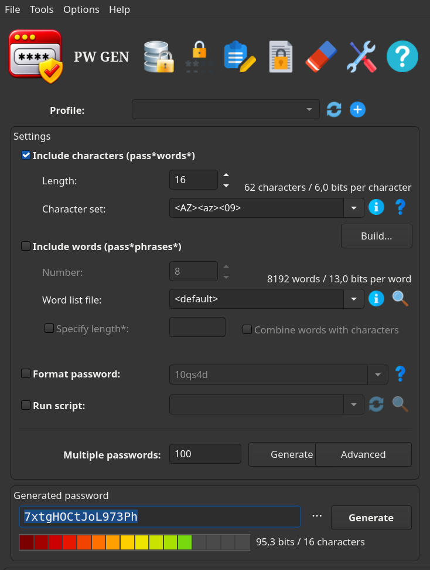

[English](README.md) | [Русский](README.ru_RU.md)

<p align="center">
  
</p>

<h1 align="center">Password Tool</h1>
<p align="center">Cryptographically secure password generator and encrypted password manager for Linux and Windows.</p>

[](https://github.com/coinman-dev/PwTool/releases/tag/v0.1.0-beta)
[](https://github.com/coinman-dev/PwTool/actions/workflows/release.yml)
[](#download)
[](#download)
[](#building)
[](LICENSE)

**Password Tool** (PwTool) is a port of [Password Tech](https://github.com/cthoeing/PasswordTech) 3.6.1
to Rust for Linux and Windows. The windows are drawn with [egui](https://github.com/emilk/egui) from
the form descriptions of the original, so the program is a single executable with no toolkit to
install. It preserves the original windows, cryptographic algorithms, and file formats: password databases (`.pwdb`), configuration files (`PwTool.ini` / `PwTech.ini`),
profiles, word lists, Lua scripts, and translations are compatible with the original Password Tech.

<p align="center">
  
</p>

> **0.1.0-beta is a prerelease.**
> Keep backups of important `.pwdb` databases before testing new releases, and report any
> issues on [GitHub Issues](https://github.com/coinman-dev/PwTool/issues). Password Tool
> is an independent port and is not affiliated with the author of Password Tech.

## Download

| Edition | Download | Usage |
|---|---|---|
| Linux package | [pwtool_0.1.0.beta_amd64.deb](https://github.com/coinman-dev/PwTool/releases/download/v0.1.0-beta/pwtool_0.1.0.beta_amd64.deb) | `sudo apt install ./pwtool_0.1.0.beta_amd64.deb` installs Password Tool with its menu entry and icons. |
| Windows installer | `pwtool_<version>_windows_x64_setup.exe` on the [releases page](https://github.com/coinman-dev/PwTool/releases) (from the next release on) | Installs for all users or only for you (no administrator rights needed), with a Start menu entry and an uninstaller. |
| Windows portable | `pwtool_<version>_windows_x64.exe` on the [releases page](https://github.com/coinman-dev/PwTool/releases) (from the next release on) | One file: save it to any folder and run it. Nothing is installed. |

Translations, script examples, and the PDF manuals are built into the program.
Linux: Ubuntu 24.04 or newer, Debian 13 or newer, amd64, Wayland or X11 with OpenGL.
Windows: 10 or 11, x64.
No advertising or telemetry.
Update checks contact only GitHub and can be disabled in **Options → Configuration**.
[All releases](https://github.com/coinman-dev/PwTool/releases) ·
[Changelog](CHANGELOG.md).

## Quick start

1. Linux: install the `.deb` package with `sudo apt install ./pwtool_0.1.0.beta_amd64.deb`.
   Windows: run `pwtool_<version>_windows_x64_setup.exe`, or save the portable
   `pwtool_<version>_windows_x64.exe` to any folder.
2. Open **Password Tool** from your application menu (**Utilities**) or run `pwtool`;
   on Windows start the `.exe` (pin it to Start or the taskbar if you like).
3. Choose a character set, passphrase word list, format string, or Lua script and click
   **Generate** — the 16-block strength meter shows estimated entropy in bits.
4. Click the database icon on the toolbar (or **File → Password Manager**) to open
   **PassCube** and store credentials in an encrypted `.pwdb` database.

The interface supports 13 languages, light, dark, and system themes, and custom GUI fonts.

## Features

- **Cryptographically secure RNG**: entropy pool backed by AES-256-CTR or ChaCha20, seeded
  from OS entropy, user input events, high-resolution timers, and optional entropy files;
  persistent random seed file on exit.
- **Flexible password generation**: character sets with custom frequency weights, ambiguous
  character exclusion, phonetic (trigram-based) passwords, word-list passphrases, pattern
  format strings, and embedded **Lua** scripting.
- **Password strength meter**: 16-block visual strength bar combining entropy calculation,
  common-password checking, and **zxcvbn** analysis.
- **PassCube password manager**: encrypted `.pwdb` databases compatible in both directions
  with Password Tech 3.6.1 (master password + optional key file, recovery key, tags,
  expiry warnings, password history, custom key-value fields, CSV import/export, backups).
- **Master-password generator (MP)**: deterministic password generation derived from a
  master password and site parameters (including Hashapass mode).
- **Text encryption**: encrypt and decrypt clipboard or arbitrary text directly from the
  toolbar.
- **Profiles & batch generation**: save reusable generator presets, generate lists of
  passwords to a window or file, or create random data and trigram files.
- **CLI mode**: generate passwords, passphrases, and formatted strings directly from the
  terminal without opening a window.
- **Built-in documentation**: `manual.pdf` and `scripting.pdf` are part of the program and
  open from **Help** or the toolbar.

## Desktop integration

Linux:

- **System tray**: StatusNotifierItem (KDE Plasma and other SNI-capable desktops), with
  minimize-to-tray and quick password generation from the tray menu.
- **Autotype & global hot keys**: implemented via `xdg-desktop-portal` (`RemoteDesktop`
  and `GlobalShortcuts`); the desktop prompts for permission on first use.
- **Secure clipboard**: copied passwords are marked as secret (`x-kde-passwordManagerHint`)
  so clipboard managers such as Klipper do not keep them in history, with configurable
  auto-clear timeout.
- **Session end**: the open database and the settings are saved when you log out (session
  monitor of `xdg-desktop-portal`).
- **KDE Plasma**: on Wayland, **Always on Top**, **Reset All Window Positions** and the
  database search by the title of the active window (hot key) work through short KWin
  scripts; without KWin the first is disabled and the last reports that it is unavailable.
  On X11 Always on Top and window positions work everywhere.

Windows (Win32 API, as in Password Tech):

- **System tray**: notification-area icon with the same menu, minimize-to-tray and balloon
  notifications.
- **Autotype & global hot keys**: `SendInput` and `RegisterHotKey`, no permission prompts.
  Windows does not let a normal program type into windows of programs running as administrator.
- **Secure clipboard**: passwords are excluded from the clipboard history (Win+V), cloud
  clipboard sync, and clipboard monitors.
- **Autostart** via the `Run` key of the current user; **Always on Top**, single instance,
  dark/light app mode of Windows followed by the **Default** style; the database and the
  settings are saved when Windows shuts down.

Not available compared with Password Tech: dragging text out of the program with the mouse
(copy and paste works). Screen readers (Narrator, NVDA, Orca) can read all windows,
including the PassCube entry list.

## Settings and data

| What | Linux | Windows |
|---|---|---|
| Program | `/usr/bin/pwtool` | `pwtool.exe` wherever you saved it |
| Built-in data (translations, common passwords, script examples, PDF manuals) | inside the program; written to `$XDG_RUNTIME_DIR/pwtool/` when used | inside the program; written to `%TEMP%\PwTool\` when used |
| Own translations (`.po`, `.lng`) | `~/.config/pwtool/` | `%APPDATA%\PwTool\` (portable mode: next to `pwtool.exe`) |
| Settings, profiles, and random seed | `~/.config/pwtool/PwTool.ini`, `randseed.dat` | `%APPDATA%\PwTool\PwTool.ini`, `randseed.dat` |
| Portable mode | Place `PwTool.ini` next to the `pwtool` binary | Place `PwTool.ini` next to `pwtool.exe` |
| Password databases (`.pwdb`) | Wherever you save them | Wherever you save them |

**Options → Restore Settings from Backup** also accepts backup files from Password Tech
(`PwTech.ini`).

## Command line

```bash
pwtool --help
pwtool --gen 5
pwtool --profile "My Profile" --gen 10
pwtool --ini /path/to/PwTool.ini --readonly
pwtool --opendb ~/vault.pwdb
pwtool --silent
```

On Windows the same options work with `pwtool.exe`; console output appears in the calling
Command Prompt or PowerShell window (or can be redirected to a file).

## Building

Requires Rust 1.90+ and a C/C++ compiler (`build-essential`); no system libraries need to
be installed for building. LibreOffice (`libreoffice-writer-nogui`) is optional: it builds
`manual.pdf` and `scripting.pdf` from `doc/manual/*.odt`, which are then embedded into the
program (run `packaging/manuals.sh` before `cargo build`).

```bash
cargo test --workspace --locked
packaging/manuals.sh               # optional: PDF manuals into target/manuals
cargo build --release --locked -p pwtool

packaging/install.sh /usr/local    # install to PREFIX
packaging/build-deb.sh             # build target/pwtool_<version>_<arch>.deb
```

### Windows build

The Windows version is cross-compiled on Linux (no Windows toolchain is needed) for the
Rust target `x86_64-pc-windows-gnullvm` with [llvm-mingw](https://github.com/mstorsjo/llvm-mingw)
(UCRT). The C runtime is linked statically: the result is one `.exe` that needs only the DLLs
of Windows itself (the build script checks this).

```bash
rustup target add x86_64-pc-windows-gnullvm
# llvm-mingw unpacked to ~/.local/opt/llvm-mingw-<version>-ucrt-ubuntu-22.04-x86_64
# (or set LLVM_MINGW); needs python3
packaging/manuals.sh                  # optional: manuals to embed
packaging/windows/build.sh            # target/pwtool_<version>_windows_x64.exe
packaging/windows/build.sh --tests    # also target/windows/tests/*.exe for running on Windows
packaging/windows/build-installer.sh  # target/pwtool_<version>_windows_x64_setup.exe (needs makensis: apt install nsis)
```

The installer (`packaging/windows/pwtool.nsi`, NSIS) asks for the language (Russian or
English) and installs either for all users into `C:\Program Files\PwTool` (administrator
rights are requested only then) or for the current user into
`%LOCALAPPDATA%\Programs\PwTool`. Optional: a desktop shortcut and starting at logon.
Settings stay in `%APPDATA%\PwTool`; the uninstaller deletes them only when asked and never
touches databases or other files there. The program must be closed before installing or
uninstalling (it is not killed: it may hold unsaved changes). Silent use:
`setup.exe /S [/AllUsers | /CurrentUser] [/D=directory]`, `uninstall.exe /S` (keeps the
settings).

Headless GUI automation and form checks:

```bash
tools/headless.sh env PWTOOL_AUTOMATE="click GenerateBtn;wait 400;print PasswBox;quit" ./target/debug/pwtool
./target/debug/pwtool --forms /tmp/forms --lang Russian --fit   # pictures of all windows, captions that do not fit
PWTOOL_DEBUG=1 ./target/debug/pwtool   # also print why the tray icon, portals etc. are not available
```

## Automated releases

Pushing a version tag such as `v0.1.0-beta` runs the
[release workflow](.github/workflows/release.yml). The tag must match `version` in
`Cargo.toml`. GitHub runs the workspace tests on Ubuntu 24.04, converts the PDF manuals,
builds and checks `pwtool_<version>_amd64.deb`, cross-builds
`pwtool_<version>_windows_x64.exe`, runs the tests and the console mode of the Windows
build on a Windows runner, computes `SHA256SUMS.txt`, and publishes the release. Tags containing a hyphen suffix are automatically marked as prereleases.

## License

GNU General Public License v2 or later — see [LICENSE](LICENSE).

Based on **Password Tech** (Copyright © 2002–2026 Christian Thöing). Third-party components
retain their own licenses: miniLZO (GPL v2+), miniz (MIT), zxcvbn-c (MIT), Lua (MIT, via
`mlua`), and the Rust crates the program is built from (egui, winit and others, MIT or
Apache-2.0; `vendor/eframe` is eframe 0.36.2 with a small accessibility patch, see
`vendor/eframe/PWTOOL-PATCH.md`), including the fallback fonts bundled with egui (Hack, Ubuntu Light, Noto Emoji,
emoji-icon-font) under their own free licenses.
