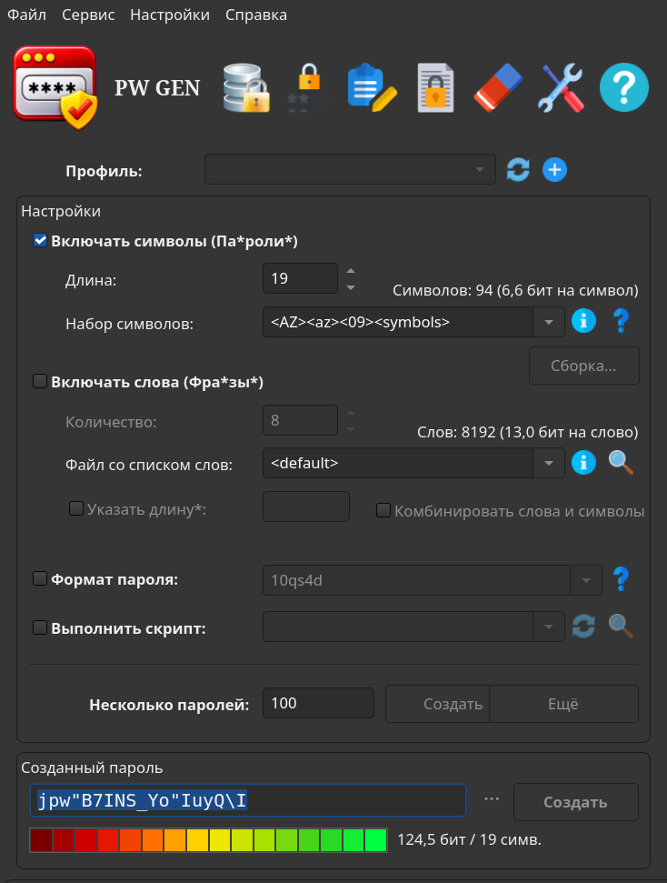

[English](README.md) | [Русский](README.ru_RU.md)

<p align="center">
  
</p>

<h1 align="center">Password Tool</h1>
<p align="center">Криптографически стойкий генератор паролей и зашифрованный менеджер паролей для Linux.</p>

[](https://github.com/coinman-dev/PwTool/releases/tag/v0.1.0-beta)
[](https://github.com/coinman-dev/PwTool/actions/workflows/release.yml)
[](#скачать)
[](#сборка)
[](LICENSE)

**Password Tool** (PwTool) — перенос [Password Tech](https://github.com/cthoeing/PasswordTech) 3.6.1
на Linux (Rust и GTK4) с максимальным сохранением поведения оригинала: те же окна,
криптографические алгоритмы и совместимые форматы файлов. Базы паролей (`.pwdb`),
настройки (`PwTool.ini` / `PwTech.ini`), профили, списки слов, скрипты Lua и переводы
совместимы с версией для Windows.

<p align="center">
  
</p>

> **0.1.0-beta — предварительный релиз.**
> Держите резервные копии важных баз `.pwdb` при тестировании бета-версий, а об ошибках
> сообщайте в [GitHub Issues](https://github.com/coinman-dev/PwTool/issues). Password Tool —
> независимый порт для Linux и не связан с автором Password Tech.

## Скачать

| Вариант | Скачать | Как использовать |
|---|---|---|
| Пакет для Linux | [pwtool_0.1.0.beta_amd64.deb](https://github.com/coinman-dev/PwTool/releases/download/v0.1.0-beta/pwtool_0.1.0.beta_amd64.deb) | `sudo apt install ./pwtool_0.1.0.beta_amd64.deb` ставит Password Tool, значки, переводы, примеры скриптов и руководства в PDF. |

Ubuntu 24.04 и новее, Debian 13 и новее, amd64 (GTK 4.10+). Рекламы и телеметрии нет.
Проверка обновлений обращается только к GitHub и отключается в **«Настройки» → «Параметры»**.
[Все релизы](https://github.com/coinman-dev/PwTool/releases) ·
[Изменения](CHANGELOG.ru_RU.md).

## Быстрый старт

1. Установите `.deb`-пакет командой `sudo apt install ./pwtool_0.1.0.beta_amd64.deb`.
2. Откройте **Password Tool** из меню приложений (**Служебные**) или запустите `pwtool`.
3. Выберите набор символов, список слов для парольной фразы, шаблон формата или скрипт Lua
   и нажмите **«Создать»** — 16-сегментная шкала покажет оценку энтропии в битах.
4. Нажмите значок базы на панели инструментов (или **«Файл» → «Менеджер паролей»**), чтобы
   открыть **PassCube** и хранить учётные данные в зашифрованной базе `.pwdb`.

Интерфейс доступен на 13 языках, поддерживает светлую, тёмную и системную темы, а также
выбор собственного шрифта интерфейса (с быстрым сбросом кнопкой «Установить по умолчанию»).

## Возможности

- **Криптографически стойкий ГСЧ**: пул энтропии на базе AES-256-CTR или ChaCha20 с
  подпиткой от ОС, событий ввода, таймера высокого разрешения и произвольных файлов;
  сохранение файла случайного зерна при выходе.
- **Гибкая генерация паролей**: наборы символов с весами частот, исключение неоднозначных
  символов, произносимые пароли по триграммам, парольные фразы по словарям, шаблоны формата
  и встроенные скрипты **Lua**.
- **Индикатор стойкости пароля**: 16 дискретных цветовых блоков с оценкой энтропии,
  проверкой по словарю распространённых паролей и анализом **zxcvbn**.
- **Менеджер паролей PassCube**: зашифрованные базы `.pwdb`, двусторонне совместимые с
  Password Tech 3.6.1 (мастер-пароль + опциональный ключевой файл, ключ восстановления,
  теги, уведомления об истечении срока, история паролей, произвольные поля «ключ–значение»,
  импорт/экспорт CSV, резервные копии).
- **Мастер-генератор (MP)**: детерминированная генерация паролей на основе мастер-пароля и
  параметров ресурса (включая режим Hashapass).
- **Шифрование текста**: шифрование и расшифровка текста или содержимого буфера обмена прямо
  с панели инструментов.
- **Профили и пакетная генерация**: сохранение пресетов генератора, генерация списков
  паролей в окно или файл, создание файлов случайных данных и таблиц триграмм.
- **Консольный режим**: генерация паролей, фраз и паролей по шаблону прямо из терминала без
  запуска графического окна.
- **Встроенная документация**: руководства `manual.pdf` и `scripting.pdf` ставятся вместе с
  программой и открываются из меню **«Справка»** или с панели инструментов.

## Интеграция с рабочим столом

- **Область уведомлений (трей)**: через StatusNotifierItem (KDE Plasma и другие окружения
  с поддержкой SNI), сворачивание в трей и быстрая генерация из контекстного меню.
- **Автонабор и глобальные горячие клавиши**: через порталы `xdg-desktop-portal`
  (`RemoteDesktop` и `GlobalShortcuts`); при первом использовании система запросит
  разрешение.
- **Безопасный буфер обмена**: скопированные пароли помечаются как секретные
  (`x-kde-passwordManagerHint`), чтобы менеджеры буфера вроде Klipper не сохраняли их в
  истории; поддерживается автоматическая очистка по таймеру.

## Настройки и данные

| Что | Где |
|---|---|
| Исполняемый файл | `/usr/bin/pwtool` |
| Ресурсы (переводы, словари, примеры скриптов, руководства PDF) | `/usr/share/pwtool/` |
| Настройки, профили и файл случайного зерна | `~/.config/pwtool/PwTool.ini`, `~/.config/pwtool/randseed.dat` |
| Переносной режим | Положите `PwTool.ini` рядом с исполняемым файлом `pwtool` |
| Базы паролей (`.pwdb`) | Там, куда вы их сохраните |

Пункт **«Восстановить настройки из резервной копии»** принимает также резервные копии
оригинального Password Tech (`PwTech.ini`).

## Командная строка

```bash
pwtool --help
pwtool --gen 5
pwtool --profile "Мой профиль" --gen 10
pwtool --ini /path/to/PwTool.ini --readonly
pwtool --opendb ~/vault.pwdb
pwtool --silent
```

## Сборка

Нужны Rust 1.90+, компилятор C/C++ (`build-essential`), `pkg-config` и `libgtk-4-dev`
(GTK 4.10 или новее). LibreOffice (`libreoffice-writer-nogui`) необязателен — используется
для сборки `manual.pdf` и `scripting.pdf` из `doc/manual/*.odt`.

```bash
cargo test --workspace --locked
cargo build --release --locked -p pwtool

packaging/install.sh /usr/local    # установка в PREFIX
packaging/build-deb.sh             # сборка target/pwtool_<версия>_<архитектура>.deb
```

Автоматизированная проверка интерфейса в виртуальной сессии:

```bash
tools/headless.sh env PWTOOL_AUTOMATE="click GenerateBtn;wait 400;print PasswBox;quit" ./target/debug/pwtool
```

## Автоматические релизы

Отправка тега версии, например `v0.1.0-beta`, запускает
[сборку релиза](.github/workflows/release.yml). Тег должен совпадать с `version` в
`Cargo.toml`. GitHub прогоняет тесты на Ubuntu 24.04, собирает PDF-руководства,
упаковывает и проверяет `pwtool_<версия>_amd64.deb`, считает `SHA256SUMS.txt` и публикует
релиз. Теги с суффиксом через дефис автоматически помечаются как предварительные (prerelease).

## Лицензия

GNU General Public License v2 или более поздняя версия — см. [LICENSE](LICENSE).

Основано на **Password Tech** (Copyright © 2002–2026 Christian Thöing). Сторонние
компоненты сохраняют свои лицензии: miniLZO (GPL v2+), miniz (MIT), zxcvbn-c (MIT) и Lua
(MIT, через crate `mlua`).
